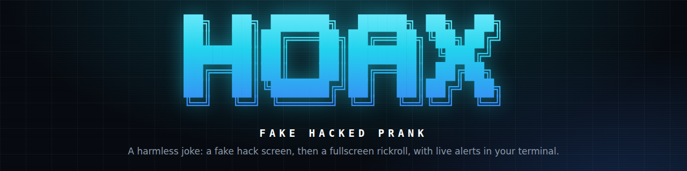
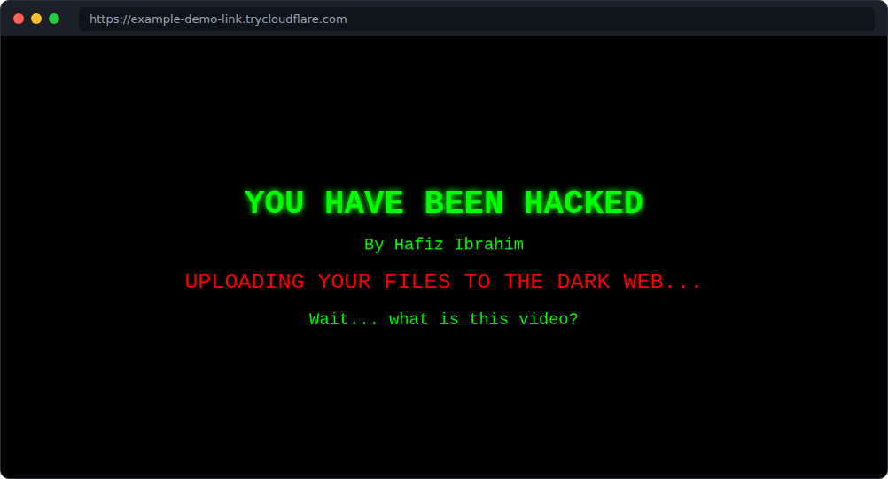
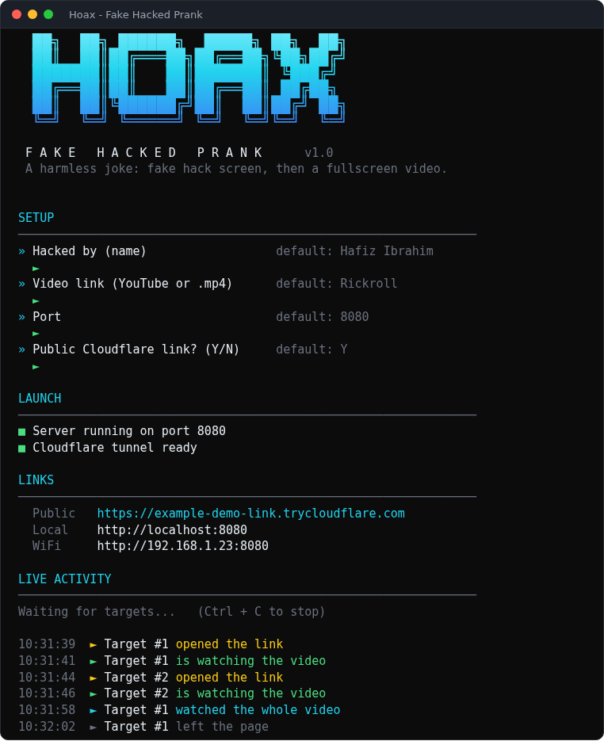

<p align="center">
  
</p>

<p align="center">
  
  
  
</p>

<p align="center">
  <b>Send a link. They see a fake hack screen, then a fullscreen rickroll.<br>You watch it happen live in your terminal.</b>
</p>

---

## Preview

<p align="center">
  <br>
  <sub>What your friend sees first, before the video takes over the whole page</sub>
</p>

<p align="center">
  <br>
  <sub>What you see in your terminal (preview image, example link)</sub>
</p>

## How it works

1. You run the launcher and answer a few questions (name, video, port, Cloudflare link).
2. You send the link to your friend.
3. They open it and see **YOU HAVE BEEN HACKED**.
4. After 4 seconds the video fills the whole page. No YouTube page, no controls, nothing to click.
5. Your terminal tells you when they open the link, start the video and leave.

## Features

- Fake hack screen with your own **"Hacked by"** name
- **Fullscreen video** on the page itself. No redirect to YouTube
- **No play / pause button.** It can't be paused, and it restarts itself if someone tries
- Autoplay that also works in **Firefox** (starts muted, the first click turns on sound and fullscreen)
- Any **YouTube link** or direct **.mp4 / .webm** link. Default is the Rickroll
- Public **Cloudflare link** that works anywhere, with no account and no port forwarding
- **Live alerts** in your terminal: opened, watching, watched the whole video, left
- **Private:** no IP address, browser or any personal info is collected or shown. People are only numbered (`Target #1`, `#2`...)
- Nothing to install: Windows uses its built-in PowerShell, Linux / macOS use the `python3` that is already there

## Quick start

**Windows**

1. Download or clone this repo
2. Double-click **`START-Windows.bat`**

**Linux / macOS**

```bash
chmod +x START-Linux-Mac.sh
./START-Linux-Mac.sh
```

Answer the questions, then send the **Public** link from the terminal to your friend.

## Questions it asks

| Question | Default | What it does |
|---|---|---|
| Hacked by (name) | `Hafiz Ibrahim` | The name shown on the fake hack screen |
| Video link | Rickroll | A YouTube link, a YouTube video ID, or a direct `.mp4` / `.webm` link |
| Port | `8080` | The port the server opens on |
| Public Cloudflare link? | `Y` | Makes a link that works from anywhere. `N` keeps it on your own network |

## Terminal alerts

```
  10:31:39  ► Target #1 opened the link
  10:31:41  ► Target #1 is watching the video
  10:31:58  ► Target #1 watched the whole video
  10:32:02  ► Target #1 left the page
```

## Links you get

| Link | Who can open it |
|---|---|
| **Public** (`trycloudflare.com`) | Anyone, anywhere. It changes every time you start the server |
| **Local** (`localhost`) | Only you, on this computer |
| **WiFi** (`192.168.x.x`) | People on the same WiFi |

## Good to know

- **Sound:** browsers only autoplay *muted* video. The first click, key press or tap anywhere on the page turns on sound and fullscreen. A small hint tells them to click.
- **Windows WiFi link:** it only works if you right-click `START-Windows.bat` and choose *Run as administrator*. The Public link works without that.
- **Cloudflare:** `cloudflared` is downloaded once into a `bin/` folder the first time you use the public link. If it fails, check your internet connection. The terminal shows the reason.
- **Stop:** press `Ctrl + C` in the terminal. The server and the tunnel both close.
- **Internet needed** on the other person's side to load the video from YouTube.

## Project files

```
Hoax-FakeHackedPrank/
├── index.html            the fake hack page + fullscreen video
├── server.ps1            Windows server (built-in PowerShell)
├── START-Windows.bat     Windows launcher
├── START-Linux-Mac.sh    Linux / macOS launcher (server is inside)
├── assets/               README images
└── README.md
```

## Disclaimer

This is a joke for friends who will laugh. It is a fake page: it doesn't hack anything, touch any files or collect any data. Don't use it to really scare or trick people who wouldn't find it funny.
